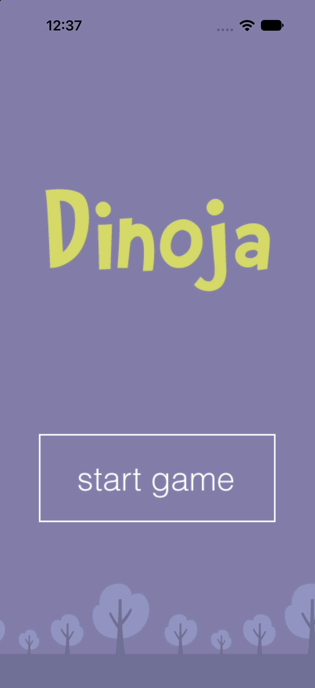
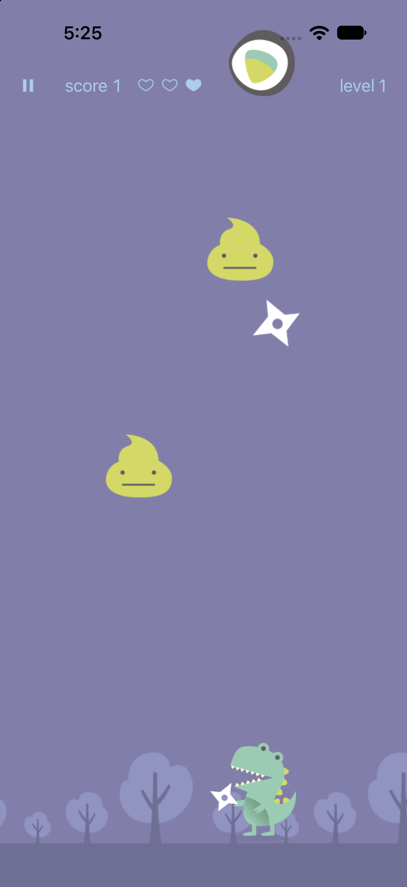

# Dinoja

A SpriteKit arcade game for iOS. Swipe to move a ninja dino and tap to throw ninja stars at falling sushi, while dodging wasabi. The goal is the highest score you can get.

<p align="center">
  
  &nbsp;&nbsp;
  
</p>

## How to Play

1. **Move** by swiping side to side. The dino turns to face the way it's going.
2. **Throw a ninja star** by tapping the screen.
3. Stars fly at a **45° angle** toward the side the dino faces and **bounce off the walls**.
4. Only **one star at a time**: you can throw again once it hits something or flies off the screen.
5. The dino has **three hearts**. Get hit by wasabi three times and the game is over.
6. Each **sushi** you shoot is worth **1 point**.
7. A **combo sushi** is worth **2 points**.
8. You **level up every 25 points**.
9. Each level, falling items **speed up**.
10. **Wasabi can't be shot**: stars pass through it, so you have to dodge it.
11. Shooting a **red heart** gives **+1 life** (up to three).
12. Shooting a **black heart** costs **1 life**.

Along the top of the screen are the pause button, your score, your hearts and your level. A "level N" banner appears each time you level up.

- **Pause:** tap the pause icon at the top left. Tap Continue to resume.
- **After a wasabi hit:** the dino shows its hit pose and blinks, and wasabi passes through it for a moment.
- **Game over:** shows your final score and level. Tap Continue to return to the start screen and play again. Scores aren't saved.

### Items

| Item | When shot |
| --- | --- |
| Ahi, salmon or avocado sushi | +1 point |
| Combo sushi | +2 points |
| Red heart | +1 life, up to 3 |
| Black heart | −1 life |
| Wasabi | Can't be shot; dodge it, or lose a life when it lands on the dino |

## Requirements

- Xcode 26 or later
- iOS 26 or later

## Getting Started

1. Clone the repository and open `Dinoja.xcodeproj` in Xcode.
2. Pick an iPhone simulator or a connected device.
3. Build and run (⌘R).

## Architecture

The game rules are plain Swift with no SpriteKit or SwiftUI, so they can be unit tested on their own.

- **`GameRules`** holds every rule and tunable number in one place, with the functions that apply them (points, life changes, levels, fall speed, spawn odds, which items can be shot).
- **Models** apply those rules:
  - `GameModel` tracks score, lives, level, the star in flight and pausing.
  - `NinjaStarFlight` computes the star's bouncing path.
  - `ContactEvent` says what each collision means.
  - `DinoPose` picks the right dino art for each direction (standing, walking or hit).
  - `Playfield` gives the visible play area.
- **`GameScene`** (SpriteKit) handles swipes and taps, draws the dino, falling items and the ninja star, and reports shots and hits to `GameModel`.
- **SwiftUI views** read `GameModel` to draw the score, hearts, pause button, pause screen and game over screen on top of the scene.

## Project Structure

| Path | Description |
| --- | --- |
| `Dinoja/DinojaApp.swift` | App entry point. |
| `Dinoja/Models/GameRules.swift` | **Every game rule and tunable value.** Edit this file to change how the game plays. |
| `Dinoja/Models/GameModel.swift` | Score, lives, level, stars in flight, playing/paused/game over state. Applies `GameRules`. |
| `Dinoja/Models/FallingItem.swift` | What can fall (sushi, wasabi, red and black hearts) and the image for each. |
| `Dinoja/Models/NinjaStarFlight.swift` | A thrown star's angled path and its bounces off the side walls. |
| `Dinoja/Models/ContactEvent.swift` | Physics categories and what each collision means (wasabi hit, target shot). |
| `Dinoja/Models/DinoPose.swift` | Which dino image to show: standing, two walking frames, or hit, for each direction. |
| `Dinoja/Models/Playfield.swift` | The on-screen area after aspect-fill cropping, and keeping objects on screen. |
| `Dinoja/Scenes/GameScene.swift` | SpriteKit gameplay: swipe and tap controls, spawning, the ninja star and collisions. |
| `Dinoja/Scenes/GameScene.sks` | Scene layout for the background and the dino. |
| `Dinoja/Views/LandingView.swift` | Start screen with the title and Start Game button. |
| `Dinoja/Views/GameView.swift` | Hosts the scene in a `SpriteView` and switches between the HUD and overlays. |
| `Dinoja/Views/HUD.swift` | The top bar: pause button, score, hearts and level. |
| `Dinoja/Views/PauseOverlay.swift` | Pause screen: the Pause title and Continue button over the background art. |
| `Dinoja/Views/GameOverOverlay.swift` | Game over screen with the final score and level, and Continue back to the start screen. |
| `Dinoja/Views/BackgroundImage.swift` | The background art, cropped to match the scene. |
| `Dinoja/Constants/Images.swift` | Names of the image assets. |
| `Dinoja/Constants/Palette.swift` | Colors sampled from the art (sky, ground, HUD blue). |
| `DinojaTests/` | Unit and integration tests (Swift Testing). |
| `DinojaUITests/` | UI tests (XCUITest). |

## Testing

Run all tests in Xcode with ⌘U.

| Suite | Kind | Covers |
| --- | --- | --- |
| `GameRulesTests` | Unit | Each of the 12 rules, spawn odds (with a seeded random generator so results are repeatable), and custom rules. |
| `GameModelTests` | Unit | Score, lives, levels, one star at a time, hearts, invincibility, pause and game over. |
| `NinjaStarFlightTests` | Unit | 45° throws, wall bounces and leaving the screen. |
| `FallingItemTests` | Unit | Image names and splat colors for every item. |
| `DinoPoseTests` | Unit | The right dino art for each direction and pose. |
| `PlayfieldTests` | Unit | Visible area on tall and wide screens, clamping and spawn bounds. |
| `ContactEventTests` | Unit | Collision rules and physics bit masks. |
| `GameSceneIntegrationTests` | Integration | Loads the real scene from `GameScene.sks` with the game loop paused, then checks swiping, turning, the hit pose, throwing, bouncing, shooting, hearts, wasabi and pausing against `GameModel`. |
| `DinojaUITests` | UI | Start screen, HUD, pause and Continue, and launch time. |

To run only the unit and integration tests from the command line (replace the simulator name with one you have installed):

```sh
xcodebuild test -project Dinoja.xcodeproj -scheme Dinoja \
  -destination 'platform=iOS Simulator,name=iPhone 17' \
  -only-testing:DinojaTests
```

## Tuning

Every rule and tunable number is in `Dinoja/Models/GameRules.swift`, grouped by rule number. For example:

| Setting | Standard value |
| --- | --- |
| `maxLives` | 3 |
| `sushiPoints` / `comboPoints` | 1 / 2 |
| `pointsPerLevel` | 25 |
| `startingFallDuration` / `fallDurationPerLevel` / `minimumFallDuration` | 4.5s / ×0.85 per level / 1.5s |
| `starAngleDegrees` / `starSpeed` | 45° / 900 points per second |
| `maxStarsInFlight` | 1 |
| `spawnWeights` | sushi 66%, wasabi 24%, red heart 5%, black heart 5% |

`GameRulesTests` checks the standard values, so changing a rule on purpose means updating its test too.
